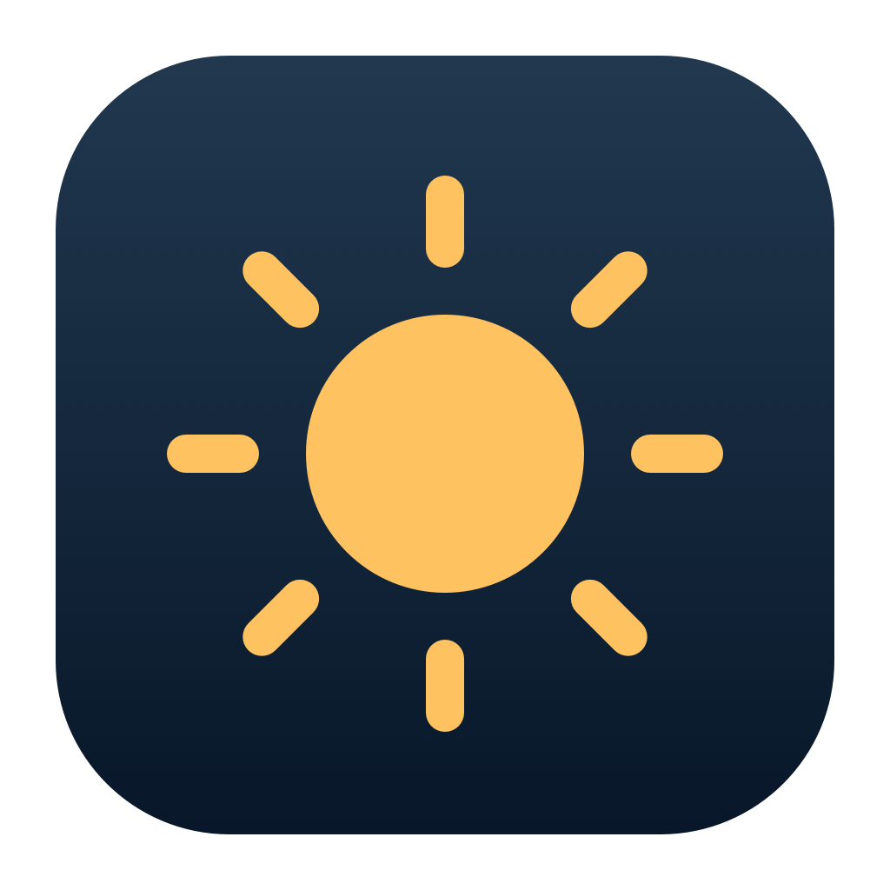
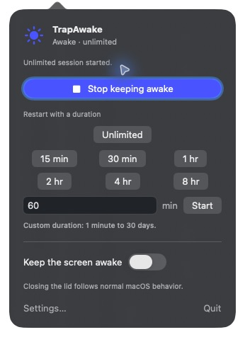
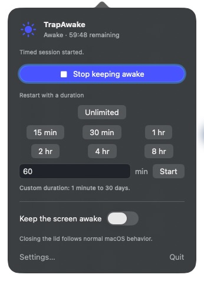

<p align="center"></p>
<h1 align="center">TrapAwake</h1>
<p align="center"><strong>Your Mac stays awake until you say otherwise.</strong></p>

TrapAwake is a free, native menu bar app for Apple Silicon Macs. Click its
sun to keep the system awake indefinitely; click again to stop. Let the
display sleep normally, or explicitly keep it on. No account, subscription,
ads, analytics, telemetry, administrator password, or background helper.

An independent, personally maintained fork of
[Insomnia](https://github.com/krishhgg/Insomnia), originally developed by
**Krish Garg (krishhgg)**. Created to replace a developer's `nosleep` terminal
alias with a simple, indefinite keep-awake workflow and native controls.
TrapAwake is not an official Insomnia release and is not affiliated with or
endorsed by its maintainers. Original MIT copyright notices and Git history
are preserved. See [NOTICE](NOTICE.md) and [the source/PR audit](docs/trapawake-audit.md).

## Features

- **Unlimited / Until Disabled**, the default. There is no hidden deadline.
- **Timed sessions**: 15/30 minutes, 1/2/4/8 hours, or custom minutes up to 30 days.
- Independent **Keep display awake** switch; system prevention stays active
  while the display follows its normal settings when the switch is off.
- One-click start/stop, with a compact sun or optional timed countdown.
- Native SwiftUI options and settings, light/dark appearance, accessible
  names, keyboard controls, and reduced-motion support.
- Battery warnings, configurable critical battery cutoff, mandatory
  critical thermal cutoff, and an optional earlier serious-heat cutoff.
- Atomic private preferences, single-instance ownership, interrupted-session
  diagnostics, and explicit recovery acknowledgement.
- Optional launch at login. Every launch starts inactive.





## Install

Requires **Apple Silicon and macOS 26 or later**. Validation is recorded in
[the release checks](docs/trapawake-validation.md); macOS 27 is a CI target,
not a claim that every hardware/OS combination was tested locally.

Download a ZIP or DMG and `SHA256SUMS` from
[Releases](https://github.com/TrapstarKS/TrapAwake/releases). Verify the files
in the same folder:

```bash
shasum -a 256 -c SHA256SUMS
```

For the ZIP, unpack it and run:

```bash
./install-trapawake.sh ./TrapAwake.app
open "$HOME/Applications/TrapAwake.app"
```

Or drag the app from the DMG to Applications. The supplied installer uses
`~/Applications` and checks a private copy of the app before replacing it.
Neither installation route installs sudoers entries or launchd jobs.

**The initial release is ad-hoc signed, not Developer ID signed or
notarized.** A checksum detects changed bytes; it is not a trust or Apple
notarization certificate. macOS may block a downloaded application. After
reviewing its source and origin, follow
[Apple's per-app approval instructions](https://support.apple.com/guide/mac-help/mh40616/mac).
Do not disable Gatekeeper or remove quarantine globally.

## Using it

1. Open TrapAwake. Its controls appear at the menu bar sun.
2. Click the sun to start the default Unlimited session. Click again to end it.
3. Right-click, Control-click, or Option-click the sun for options. Select a
   timed preset or custom duration there, or change the default in Settings.
4. Enable **Keep display awake** only when you want that additional hold.
5. Open Settings with the button or **⌘,**. **Escape** closes the popover;
   **Return** activates its primary action; **⌘Q** quits and releases the hold.

Closing the popover or Settings does not end a session. A timed countdown
uses a continuous clock, so changing the system clock does not extend it.
The normal idle sleep settings take effect again when its assertions end;
TrapAwake never rewrites those settings.

Unlimited means **no time limit**, while battery and thermal safeguards
continue to apply. It lasts only while this process owns its assertions.
Quit, crash, force quit, logout or reboot ends the hold. A later launch
never silently resumes a timed or unlimited session. An interrupted marker
is shown for acknowledgement and archived for diagnosis.

## Display, lid, and limits

The system hold prevents **idle system sleep**. The optional display hold
prevents **idle display sleep**. Existing display settings can already be
set to Never; disabling TrapAwake's display hold does not change that.
Other applications can also keep the display or system awake.

TrapAwake does not suppress the screen lock, override deliberate Sleep or
emergency shutdown, or force a closed-lid laptop to remain awake. Normal
[Apple clamshell requirements](https://support.apple.com/en-us/102501) still
apply. Closed-lid overrides are not enabled: the audit found privileged,
version-sensitive global sleep changes and private display APIs in the
original implementation. They are kept as historical source, with their
recovery tests, and are not called by TrapAwake.

Automatic process/agent sessions, CLI session control, app freezing,
hotspot handoff and tmux automation are deferred. There is no process
polling in the shipping awake lifecycle.

Keep the Mac on a ventilated surface. The app uses macOS thermal states,
not a raw temperature sensor, and is not a hardware safety guarantee.
See [Apple's temperature guidance](https://support.apple.com/en-us/102336).

## Safety and recovery

The default warning is 20% battery; the session ends at or below 10% while
on battery. Both are configurable, with a nonzero critical cutoff. A
battery that stays unreadable on battery power also ends the hold. Critical
heat always ends it; stopping at serious heat is on by default. Connecting
or disconnecting the charger is handled by the native power monitor.
TrapAwake does not alter Low Power Mode, brightness, audio, other apps'
preferences, or process scheduling.

Official [IOPM assertions](https://developer.apple.com/documentation/iokit/1557134-iopmassertioncreatewithname)
belong to the process. macOS releases them when that process exits, so no
privileged persistent power setting needs a launchd backstop. A session
marker is recorded before acquisition, removed after successful release,
and retained on a partial cleanup failure. The app reports that failure
and offers a retry; unreadable recovery evidence is preserved.

Preferences live in `~/Library/Application Support/TrapAwake/preferences.json`;
logs in `~/Library/Logs/TrapAwake/`. Files are created with mode 0600 and
app-owned directories with mode 0700. Inspect logs before sharing them.
[Security details](SECURITY.md) · [architecture](docs/trapawake-architecture.md).

## Build from source

Install full Xcode with Swift 6.2 or later, then:

```bash
git clone https://github.com/TrapstarKS/TrapAwake.git
cd TrapAwake
swift build
swift test
./scripts/package-trapawake.sh
./scripts/install-trapawake.sh
open "$HOME/Applications/TrapAwake.app"
```

If Command Line Tools is selected, prefix Swift commands with
`DEVELOPER_DIR=/Applications/Xcode.app/Contents/Developer`. The build script
selects that installed Xcode for its own process when needed.

`dist/` contains the signed app, ZIP, DMG and checksums. The tests use fake
assertion drivers and temporary directories; they do not change your power
settings. Legacy regression tests remain to protect reused components.
See [contributing](CONTRIBUTING.md) and
[distribution/signing](docs/trapawake-distribution.md). Original installation
scripts under `scripts/install.sh` and `scripts/uninstall.sh` are historical
Insomnia utilities; use only the scripts with **trapawake** in their names.

## Uninstall

From this checkout or the extracted ZIP:

```bash
./scripts/uninstall-trapawake.sh          # checkout
./uninstall-trapawake.sh                 # extracted ZIP
```

It unregisters the login item, quits the app, verifies it has exited, and
removes the owned user-level bundle. `--purge` also removes known preference
and log files, retaining recovery evidence and the stable ownership lock.
If installed in `/Applications` from the DMG, first turn off launch at login
in Settings, quit, and move that copy to Trash. No power preferences need
resetting. Removal of an older Insomnia installation is a separate operation
that must retain its recovery evidence until its own cleanup succeeds.

## Origin and contributions

Based on Insomnia commit `b6a7499c183b82eb30b5e969489e6a7420250eea` (October 13,
2026), after its stable 0.1.0. Its power observer, private file utilities,
login item support and session formatting are reused. The legacy engine and
tests remain for reference; the shipping app uses a smaller assertion-only
lifecycle because the original engine assumes global privileged pmset changes.

Community PRs #75, #99, #96, #93, #79 and #72 were audited individually.
None was merged wholesale; decisions and inspected commits are in
[the audit](docs/trapawake-audit.md). Original contributors are credited in
[NOTICE](NOTICE.md) and the preserved commit history. Changes are developed
for this independent fork; there is no automatic upstream synchronization
and no upstream PR is required or planned.

## License

[MIT](LICENSE). Original copyright © 2026 Krish Garg is preserved.
[Changelog](CHANGELOG.md).
